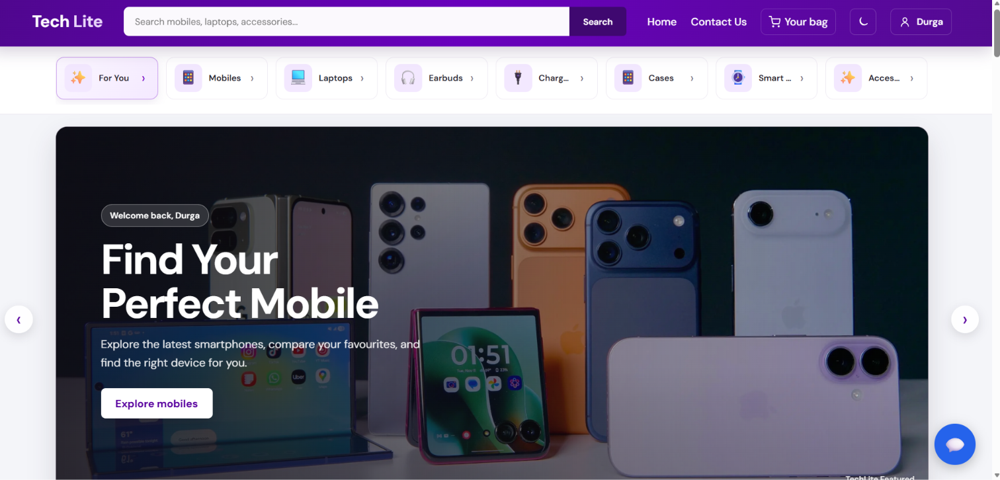

\# 🛍️ TechLite – Smart Mobile Store


A full-stack e-commerce web application developed to provide a convenient online shopping experience for smartphones, laptops, and electronic accessories.


🌐 \*\*Live Website:\*\* https://techlite-new.onrender.com


\## 📌 About the Project


TechLite is a Smart Mobile Store developed using React and FastAPI. Customers can browse electronic products, manage their shopping carts, place orders, and receive order notifications.


The application also includes an admin dashboard, AI-powered chatbot, payment integration, and automated email notifications using n8n.


\## ✨ Key Features


\### Customer Features

\- User registration and login

\- Google authentication

\- Product browsing and search

\- Product categories and sorting

\- Product stock availability

\- Shopping cart management

\- Order placement and tracking

\- Online payment integration

\- Password reset using email OTP

\- Contact Us form

\- AI-powered shopping chatbot


\### Admin Features

\- Admin dashboard

\- Product management

\- Inventory and stock monitoring

\- Order management

\- Customer message management

\- Order notification monitoring

\- Sales and analytics dashboard


\### AI Chatbot

\- Product recommendations

\- Budget-based product search

\- Customer assistance

\- Image and PDF uploads

\- AI-powered responses


\### Automation

\- n8n workflow integration

\- Automated order email notifications

\- Order notification reliability and retry handling


\## 🛠️ Technologies Used


| Area | Technologies |

|---|---|

| Frontend | React.js, JavaScript, HTML, CSS |

| Backend | Python, FastAPI |

| Database | SQLite, PostgreSQL support |

| AI | Groq API |

| Payment | Razorpay |

| Automation | n8n |

| Email | SMTP, Resend |

| Authentication | JWT, Google Authentication |

| Deployment | Render |

| Version Control | Git, GitHub |


\## 🏗️ Project Architecture


```text

&#x20;            CUSTOMER

&#x20;                |

&#x20;                v

&#x20;      REACT FRONTEND

&#x20;                |

&#x20;                v

&#x20;       FASTAPI BACKEND

&#x20;                |

&#x20;      +---------+---------+

&#x20;      |         |         |

&#x20;      v         v         v

&#x20;   DATABASE  AI CHATBOT  PAYMENTS

&#x20;      |         |         |

&#x20;      |         |         |

&#x20;      +---------+---------+

&#x20;                |

&#x20;                v

&#x20;         ORDER PROCESSING

&#x20;                |

&#x20;                v

&#x20;            n8n WEBHOOK

&#x20;                |

&#x20;                v

&#x20;        EMAIL NOTIFICATIONS

```


\## 📂 Project Structure


```text

Smart-Mobile-Store/

│

├── backend/

│   ├── app/

│   │   ├── routers/

│   │   ├── services/

│   │   ├── models.py

│   │   ├── database.py

│   │   ├── config.py

│   │   └── main.py

│   │

│   └── requirements.txt

│

├── frontend-new/

│   ├── public/

│   ├── src/

│   ├── package.json

│   └── vite.config.js

│

└── README.md

```


\## 🚀 Live Deployment


The application is deployed using Render.


\*\*Live Application:\*\* https://techlite-new.onrender.com


\## 💻 Running the Project Locally


\### 1. Clone the Repository


```bash

git clone https://github.com/Durga-0812/Smart-Mobile-Store.git

```


\### 2. Navigate to the Project


```bash

cd Smart-Mobile-Store

```


\### 3. Backend Setup


```bash

cd backend

python -m venv .venv

```


Activate the virtual environment on Windows:


```powershell

.venv\\Scripts\\Activate.ps1

```


Install dependencies:


```bash

pip install -r requirements.txt

```


Configure the required environment variables in `backend/.env`.


Start the backend:


```bash

uvicorn app.main:app --reload

```


Backend API:


```text

http://127.0.0.1:8000

```


API documentation:


```text

http://127.0.0.1:8000/docs

```


\### 4. Frontend Setup


Open another terminal:


```bash

cd frontend-new

npm install

npm run dev

```


Frontend:


```text

http://localhost:5173

```


\## 🔐 Environment Configuration


Configure the required environment variables before running the application.


Examples include:


\- DATABASE\_URL

\- JWT\_SECRET

\- ADMIN\_SETUP\_SECRET

\- GOOGLE\_CLIENT\_ID

\- GROQ\_API\_KEY

\- RAZORPAY\_KEY\_ID

\- RAZORPAY\_KEY\_SECRET

\- SMTP\_EMAIL

\- SMTP\_PASSWORD

\- N8N\_ORDER\_WEBHOOK\_URL


Never upload `.env` files, passwords, API keys, or private credentials to GitHub.


\## 📸 Project Screenshots


Screenshots of the following application sections can be added here:


\- Homepage

\- Product collection

\- Login and registration

\- Shopping cart

\- Checkout

\- Admin dashboard

\- AI chatbot

\- Order management


\## 🎯 Project Objective


The objective of TechLite is to develop a complete e-commerce application that combines modern frontend development, backend API development, database management, AI integration, payment processing, and workflow automation.


\## 👩‍💻 Developer


\*\*Project Name:\*\* Smart Mobile Store  

\*\*Team Name:\*\* TechLite  

\*\*Role:\*\* Software Development Intern  

\*\*GitHub:\*\* https://github.com/Durga-0812/Smart-Mobile-Store


\---


⭐ If you find this project interesting, consider giving the repository a star!


## 📸 Project Screenshots

### TechLite Homepage




